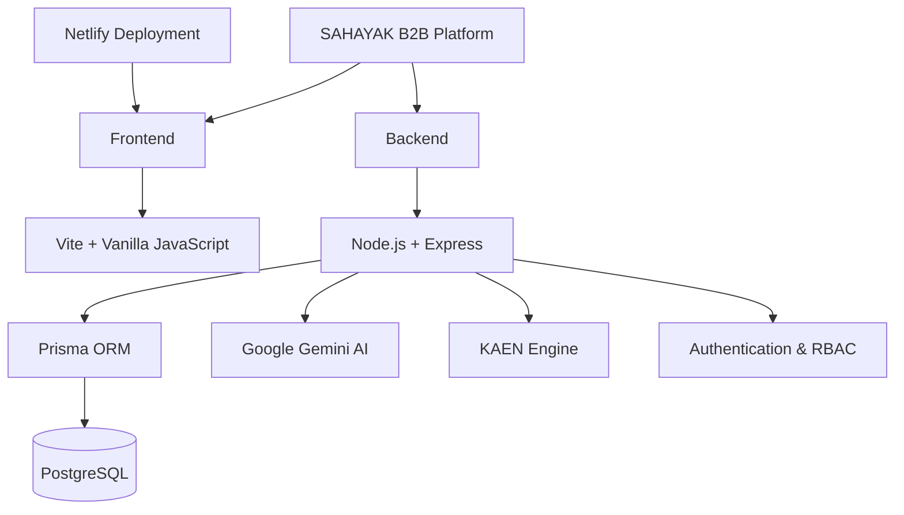

# 💜 SAHAYAK B2B — AI-Powered Business & Trade Marketplace

<div align="center">


### Connecting Buyers, Retailers, Wholesalers, Manufacturers & Logistics Partners

**An intelligent B2B commerce platform designed to simplify business discovery, procurement, negotiation and trade management.**

<br/>

[](https://sahayak-b2b.netlify.app/)
[](https://github.com/venkatavarshith999/SAHAYAK-B2B)

<br/>


</div>

---

## 🌐 Explore the Sahayak Ecosystem

The Sahayak ecosystem consists of two connected platforms designed to provide AI assistance and simplify business operations.

| Platform | Live Website | GitHub Repository |
|---|---|---|
| 💜 **Sahayak AI — Customer Portal** | [Visit Website](https://sahayak-ai-customer-website.vercel.app/) | [View Repository](https://github.com/jayasankartanguturi/SAHAYAK-AI-CUSTOMER-WEBSITE) |
| 🏢 **Sahayak B2B — Business Portal** | [Visit Website](https://sahayak-b2b.netlify.app/) | [View Repository](https://github.com/venkatavarshith999/SAHAYAK-B2B) |

### 💜 Sahayak AI — Customer Portal

**AI Assistance for Every Profession**

An AI-powered customer platform designed to provide profession-based assistance, multilingual support and useful information through a unified interface.

- [🌐 Live Website](https://sahayak-ai-customer-website.vercel.app/)
- [💻 GitHub Repository](https://github.com/jayasankartanguturi/SAHAYAK-AI-CUSTOMER-WEBSITE)

### 🏢 Sahayak B2B — Business & Trade Portal

**Smart Business. Better Connections. Stronger Trade.**

An AI-powered marketplace connecting retailers, buyers, wholesalers, manufacturers and logistics partners.

- [🌐 Live Website](https://sahayak-b2b.netlify.app/)
- [💻 GitHub Repository](https://github.com/venkatavarshith999/SAHAYAK-B2B)

---

## ✨ About the Project

**SAHAYAK B2B** is an AI-powered business and trade marketplace that connects different participants in the supply chain through a unified digital platform.

The platform helps businesses discover suppliers, explore products, manage quotations, negotiate prices and coordinate business operations.

It combines AI-powered market assistance with structured business workflows to make B2B procurement more accessible and efficient.

### 🎯 Our Mission

To simplify business transactions by connecting the right buyers and sellers through intelligent technology, transparent pricing and smarter negotiation.

---

## 🚀 Key Features

<table>
<tr>
<td width="50%">

### 🤖 AI Business Assistant

- Gemini-powered business assistance.
- Role-aware AI responses.
- Business-related queries.
- Market intelligence assistance.

</td>
<td width="50%">

### 🤝 KAEN Negotiation Engine

- Structured multi-round negotiation.
- Automated concession curves.
- Buyer-seller negotiation workflows.
- Dual-party approval.

</td>
</tr>
<tr>
<td width="50%">

### 🏢 Business Management

- Business registration.
- Organization profiles.
- Business verification.
- Role-based access control.

</td>
<td width="50%">

### 📦 Product & Procurement

- Product catalogue management.
- Buyer and seller connectivity.
- RFQ management.
- Quotations and orders.

</td>
</tr>
<tr>
<td width="50%">

### 🚚 Logistics Management

- Logistics partner portal.
- Shipment tracking workflows.
- Delivery assignments.
- Proof of delivery.

</td>
<td width="50%">

### 🛡️ Security & Administration

- Secure authentication.
- Google OAuth.
- Admin verification.
- Audit logging.
- Organization-level isolation.

</td>
</tr>
</table>

---

## 👥 Five Dedicated Portals

| Portal | Purpose |
|---|---|
| 🛒 Retailer / Buyer | Discover suppliers, request quotations and negotiate |
| 📦 Wholesaler / Seller | Manage products, enquiries and quotations |
| 🏭 Manufacturer | Manage production capacity and bulk orders |
| 🚚 Logistics Partner | Manage shipment and delivery workflows |
| 🔐 Super Admin | Manage users, business verification and platform operations |

Each portal provides role-specific functionality through a unified platform.

---

## 🧠 KAEN — Intelligent Negotiation Engine

KAEN is the platform's structured negotiation engine.

It supports multi-round bargaining through concession curves and negotiation workflows.

**Negotiation Flow**

1. Buyer initiates a negotiation.
2. Seller reviews the proposed terms.
3. KAEN evaluates the negotiation round.
4. Both parties review the updated offer.
5. The parties approve the final terms.

**Goal:** Make bulk procurement negotiations more structured and transparent.

---

## 🏗️ System Architecture



### Technology Stack

| Layer | Technology |
|---|---|
| Frontend | Vite 5, Vanilla JavaScript |
| Styling | Custom CSS Design System |
| Backend | Node.js, Express.js |
| Database | PostgreSQL |
| ORM | Prisma |
| AI Integration | Google Gemini 2.5 Flash |
| Authentication | Argon2id, Google OAuth |
| Sessions | HttpOnly Cookies |
| Deployment | Netlify |

---

## 🎨 UI / UX Design

SAHAYAK B2B follows a modern purple-and-white SaaS design system.

**Brand Identity**

- Primary Purple: `#7C3AED`
- Deep Purple: `#6D28D9`
- Soft Lavender: `#F5F3FF`
- White: `#FFFFFF`
- Background: `#F7F7FB`
- Primary Text: `#16142C`

**Design Elements**

- Clean dashboard layouts.
- Rounded cards and subtle shadows.
- Responsive navigation.
- Consistent typography.
- Smooth page transitions.
- Interactive hover effects.
- Animated gradient backgrounds.

### ✨ Motion & Micro-Interactions

The frontend includes a dedicated animation stylesheet.

- Fade-in page entrances.
- Slide-up content transitions.
- Floating dashboard elements.
- Animated gradients.
- Shimmer effects.
- Smooth hover lift.
- Interactive ripple effects.
- Typing indicators.
- Staggered card animations.

The animation system is designed to make the interface feel responsive without distracting users from business workflows.

---

## 🔐 Security Architecture

- Argon2id password hashing.
- HttpOnly session cookies.
- SHA-256 hashed session token storage.
- Role-based access control (RBAC).
- Organization-level access isolation.
- Google OAuth verification.
- API rate limiting.
- CSRF origin protection.
- Security headers using Helmet.
- Tamper-evident audit logs.

---

## 📁 Project Structure

```text
SAHAYAK-B2B/
│
├── backend/
│   ├── src/
│   │   ├── server.js
│   │   ├── auth/
│   │   ├── ai/
│   │   ├── kaen/
│   │   ├── config/
│   │   ├── middleware/
│   │   └── routes/
│   │
│   └── prisma/
│       └── schema.prisma
│
├── frontend/
│   ├── index.html
│   ├── vite.config.js
│   └── src/
│       ├── main.js
│       ├── router.js
│       ├── store.js
│       ├── api.js
│       │
│       ├── styles/
│       │   ├── design-system.css
│       │   ├── components.css
│       │   └── animations.css
│       │
│       ├── components/
│       │   ├── sidebar.js
│       │   ├── ai-copilot.js
│       │   ├── kaen-room.js
│       │   └── toast.js
│       │
│       └── pages/
│           ├── welcome.js
│           ├── login.js
│           ├── register.js
│           └── dashboard/
│
├── netlify/
│   └── server/
│
├── netlify.toml
├── package.json
└── README.md
```

---

## ⚙️ Getting Started

### Prerequisites

- Node.js 20 or higher.
- PostgreSQL 15 or compatible PostgreSQL database.
- Google Gemini API key.
- Google OAuth credentials (if using Google Sign-In).

### 1. Clone the Repository

```bash
git clone https://github.com/venkatavarshith999/SAHAYAK-B2B.git

cd SAHAYAK-B2B
```

### 2. Install Dependencies

```bash
npm run install:all
```

### 3. Configure Environment Variables

Create the backend environment file:

```bash
cp backend/.env.example backend/.env
```

Configure the following values:

```env
DATABASE_URL="your-postgresql-connection-string"

PORT=4000
NODE_ENV="development"

FRONTEND_ORIGIN="http://localhost:5173"

SESSION_SECRET="your-secure-session-secret"
SESSION_TTL_HOURS=24

GOOGLE_CLIENT_ID="your-google-client-id"
GOOGLE_CLIENT_SECRET="your-google-client-secret"
GOOGLE_REDIRECT_URI="http://localhost:4000/api/auth/google/callback"

GEMINI_API_KEY="your-gemini-api-key"
GEMINI_MODEL="gemini-2.5-flash"
```

Never commit real API keys, passwords or database credentials.

### 4. Generate Prisma Client

```bash
npm run db:generate
```

### 5. Run Database Migrations

```bash
npm run db:migrate
```

### 6. Start Backend

```bash
npm run dev:backend
```

Backend:

`http://localhost:4000`

### 7. Start Frontend

Open another terminal:

```bash
npm run dev:frontend
```

Frontend:

`http://localhost:5173`

---

## 🌐 Deployment

The project includes Netlify deployment configuration.

**Live Application**

[https://sahayak-b2b.netlify.app/](https://sahayak-b2b.netlify.app/)

**Deployment Configuration**

- Frontend build output: `frontend/dist`
- Deployment configuration: `netlify.toml`
- Netlify build command: `npm run build:netlify`
- Node.js version configured in Netlify: 24

Production deployment requires correctly configured database, authentication and AI environment variables.

---

## 🔌 API Overview

| API Route | Purpose |
|---|---|
| `/api/auth` | Authentication |
| `/api/org` | Organization management |
| `/api/buyer` | Buyer operations |
| `/api/seller` | Seller operations |
| `/api/worker` | Worker operations |
| `/api/logistics` | Logistics operations |
| `/api/rfqs` | Request for quotation |
| `/api/orders` | Order management |
| `/api/ai/chat` | AI business assistant |
| `/api/kaen/negotiate` | Negotiation engine |
| `/api/notifications` | Notifications |
| `/api/admin` | Administration |

---

## 🗺️ Future Development

- Expand AI-powered business intelligence.
- Improve supplier and product discovery.
- Enhance negotiation capabilities.
- Expand logistics integrations.
- Improve marketplace analytics.
- Strengthen scalability and security.
- Introduce additional business categories.

---

## 🤝 Contributing

Contributions and suggestions are welcome.

1. Fork the repository.
2. Create a feature branch.
3. Make your changes.
4. Test your implementation.
5. Submit a pull request.

---

## 💜 Project Links

<div align="center">

### 💜 SAHAYAK AI — Customer Portal

**AI Assistance for Every Profession**

[🌐 Visit Sahayak AI Website](https://sahayak-ai-customer-website.vercel.app/)

[💻 Explore Sahayak AI Repository](https://github.com/jayasankartanguturi/SAHAYAK-AI-CUSTOMER-WEBSITE)

---

### 🏢 SAHAYAK B2B — Business & Trade Portal

**Smart Business. Better Connections. Stronger Trade.**

[🌐 Visit Sahayak B2B Website](https://sahayak-b2b.netlify.app/)

[💻 Explore Sahayak B2B Repository](https://github.com/venkatavarshith999/SAHAYAK-B2B)

</div>

---

## 📄 License

Private project. All rights reserved.

---

<div align="center">

### 💜 Built to Connect People, Assist Professions & Simplify Trade.

**SAHAYAK AI × SAHAYAK B2B**

*Discover • Connect • Assist • Negotiate • Grow*

</div>
